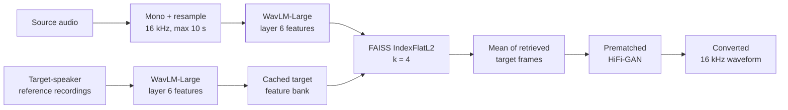

# Zero-Shot Voice Conversion with WavLM and kNN Retrieval

**Training-free, any-to-any voice conversion that transfers a target speaker's voice while preserving the source utterance's linguistic content.**

The pipeline extracts content representations from WavLM-Large, retrieves the nearest target-speaker frames with FAISS, and synthesizes the matched representation with a prematched HiFi-GAN vocoder. Target speakers are added by building a reference feature bank—no fine-tuning or speaker-specific model training is required.


## Highlights

- **Zero-shot conversion:** adapt to a target speaker from reference recordings without gradient-based training.
- **Self-supervised speech features:** extract 1,024-dimensional content representations from WavLM-Large layer 6.
- **Frame-level voice transfer:** retrieve target frames with exact FAISS L2 search and average the four nearest neighbors.
- **Neural waveform synthesis:** generate 16 kHz audio with the prematched HiFi-GAN model from `bshall/knn-vc`.
- **Reusable speaker banks:** cache per-utterance target features as NumPy arrays for repeated conversion.
- **End-to-end evaluation:** measure speaker similarity, content preservation, predicted speech quality, and conversion speed.
- **Config-driven workflow:** control data, audio, feature extraction, retrieval, device, and output settings from one YAML file.

## Pipeline



WavLM provides the frame-level representation used for matching. For every source frame, FAISS finds the four closest frames in the target speaker's feature bank. Their mean is passed to the vocoder, preserving the source sequence length while replacing its acoustic representation with target-speaker frames.

## Audio Samples

| Source | Target | Speaker similarity | WER | DNSMOS OVRL | Converted audio |
|---|---:|---:|---:|---:|---|
| `p226_001_mic1` | `p225` | 0.6788 | 0.0000 | 3.1553 | [Listen](results/audio/p226_001_mic1_to_p225.wav) |
| `p228_001_mic1` | `p226` | 0.5846 | 0.0000 | 3.0176 | [Listen](results/audio/p228_001_mic1_to_p226.wav) |
| `p226_002_mic1` | `p227` | 0.5027 | 0.0000 | 3.3225 | [Listen](results/audio/p226_002_mic1_to_p227.wav) |

## Results

The checked-in evaluation covers 10 any-to-any conversions across 7 speakers from VCTK 0.92. Results were produced on an NVIDIA GeForce RTX 3060 12 GB using the pairs in [`eval_pairs.txt`](eval_pairs.txt).

### Summary

| Metric | Mean | Direction | Measurement |
|---|---:|:-:|---|
| ECAPA-TDNN speaker similarity | **0.5618** | ↑ | Cosine similarity between converted audio and a target-speaker reference |
| Whisper `base.en` WER | **0.0333** | ↓ | Word error rate between source and converted-audio transcripts |
| DNSMOS OVRL | **3.1757** | ↑ | Predicted overall speech quality |
| Real-time factor | **0.2746** | ↓ | Conversion time divided by source-audio duration |

An average real-time factor of `0.2746` corresponds to approximately **3.6 seconds of audio processed per second of conversion time**.

<details>
<summary><strong>Per-pair results</strong></summary>

| Source | Target | Speaker similarity | WER | DNSMOS OVRL | RTF | Audio |
|---|---:|---:|---:|---:|---:|---|
| `p226_001_mic1` | `p225` | 0.6788 | 0.0000 | 3.1553 | 0.1144 | [WAV](results/audio/p226_001_mic1_to_p225.wav) |
| `p226_002_mic1` | `p227` | 0.5027 | 0.0000 | 3.3225 | 0.2008 | [WAV](results/audio/p226_002_mic1_to_p227.wav) |
| `p227_001_mic1` | `p228` | 0.5767 | 0.0000 | 3.0909 | 0.2618 | [WAV](results/audio/p227_001_mic1_to_p228.wav) |
| `p227_002_mic1` | `p225` | 0.5879 | 0.0000 | 3.1338 | 0.2332 | [WAV](results/audio/p227_002_mic1_to_p225.wav) |
| `p228_001_mic1` | `p226` | 0.5846 | 0.0000 | 3.0176 | 0.3670 | [WAV](results/audio/p228_001_mic1_to_p226.wav) |
| `p228_002_mic1` | `p229` | 0.5522 | 0.0000 | 3.3338 | 0.2171 | [WAV](results/audio/p228_002_mic1_to_p229.wav) |
| `p229_001_mic1` | `p230` | 0.5424 | 0.0000 | 2.9414 | 0.4686 | [WAV](results/audio/p229_001_mic1_to_p230.wav) |
| `p229_002_mic1` | `p226` | 0.4356 | 0.0000 | 3.4086 | 0.2590 | [WAV](results/audio/p229_002_mic1_to_p226.wav) |
| `p230_001_mic1` | `p231` | 0.5808 | 0.3333 | 3.1513 | 0.4051 | [WAV](results/audio/p230_001_mic1_to_p231.wav) |
| `p230_002_mic1` | `p225` | 0.5763 | 0.0000 | 3.2017 | 0.2193 | [WAV](results/audio/p230_002_mic1_to_p225.wav) |

</details>

The complete machine-readable results, including source and converted transcripts, are available in [`results/metrics/eval_results.json`](results/metrics/eval_results.json). See [`BENCHMARK.md`](BENCHMARK.md) for the compact benchmark report.

## Installation

The checked-in configuration targets CUDA. The project environment used Python 3.10, PyTorch 2.6.0 with CUDA 12.4, and FAISS-GPU 1.7.4.

```bash
conda create -n knn-vc python=3.10 -y
conda activate knn-vc

pip install torch==2.6.0 torchaudio==2.6.0 \
  --index-url https://download.pytorch.org/whl/cu124
conda install -c pytorch -c nvidia faiss-gpu=1.7.4 -y
pip install -r requirements.txt \
  --extra-index-url https://download.pytorch.org/whl/cu124
```

Expose the repository root on `PYTHONPATH` before running the scripts:

```bash
# Linux / macOS
export PYTHONPATH="$(pwd)"
```

```powershell
# Windows PowerShell
$env:PYTHONPATH = (Get-Location).Path
```

The first feature-extraction or conversion run loads the upstream `bshall/knn-vc` model through Torch Hub. Evaluation additionally loads the SpeechBrain ECAPA-TDNN and Whisper `base.en` checkpoints.

## Data Preparation

1. Obtain VCTK 0.92.
2. Set `data.vctk_root` in [`configs/default.yaml`](configs/default.yaml) to the directory containing `wav48_silence_trimmed/`.
3. Use the mic1 recordings for the reproduced setup. If the corpus copy contains mic2 files, remove them from that working copy before feature extraction:

```bash
find /path/to/VCTK-Corpus/wav48_silence_trimmed \
  -type f -name "*_mic2.flac" -delete
```

The expected layout is:

```text
VCTK-Corpus/
└── wav48_silence_trimmed/
    ├── p225/
    │   ├── p225_001_mic1.flac
    │   └── ...
    ├── p226/
    └── ...
```

For batch evaluation, replace the machine-specific source paths in [`eval_pairs.txt`](eval_pairs.txt). Each non-comment line contains a source file followed by a target speaker ID:

```text
/absolute/path/to/p226/p226_001_mic1.flac p225
```

## Quick Start

### 1. Build target-speaker feature banks

```bash
python scripts/extract_features.py --config configs/default.yaml
```

The extractor writes one `.npy` file per reference utterance under `results/features/<speaker_id>/`. Existing files are skipped, so interrupted extraction can be resumed with the same command.

### 2. Convert one utterance

```bash
python scripts/convert.py \
  --config configs/default.yaml \
  --source /path/to/source.flac \
  --target p225 \
  --output results/audio/converted.wav
```

The target speaker ID must have a feature bank created by the previous step.

### 3. Run the evaluation suite

```bash
python scripts/evaluate.py \
  --config configs/default.yaml \
  --pairs eval_pairs.txt \
  --output results/metrics/eval_results.json
```

This command converts every pair and records per-pair plus mean speaker similarity, WER, DNSMOS OVRL, and real-time factor.

## Training and Adaptation

This project uses retrieval-based adaptation rather than a task-specific training loop. Adding a target speaker consists of placing that speaker's VCTK-style reference recordings under the configured corpus root and running `scripts/extract_features.py`. The shared WavLM and HiFi-GAN weights remain unchanged.

To extract only selected target speakers, set `data.speakers` in `configs/default.yaml`:

```yaml
data:
  speakers: [p225, p226, p227]
```

## Configuration

Runtime behavior is controlled by [`configs/default.yaml`](configs/default.yaml).

| Key | Checked-in value | Purpose |
|---|---:|---|
| `data.vctk_root` | local path | VCTK 0.92 corpus root |
| `data.features_dir` | `results/features` | Cached speaker feature banks |
| `data.speakers` | `null` | Optional explicit speaker-ID list |
| `data.max_speakers` | `30` | Maximum speakers when no list is supplied |
| `data.audio_ext` | `flac` | Reference-audio extension |
| `audio.sample_rate` | `16000` | Model and output sample rate |
| `audio.max_duration_sec` | `10.0` | Maximum input duration processed per file |
| `wavlm.content_layer` | `6` | WavLM layer used for matching |
| `wavlm.device` | `cuda` | Feature-extractor device |
| `knn.k` | `4` | Nearest target frames averaged per source frame |
| `knn.use_gpu` | `true` | Use a FAISS GPU index when available |
| `vocoder.device` | `cuda` | HiFi-GAN inference device |
| `results.audio_dir` | `results/audio` | Batch-conversion audio output |

## Repository Structure

```text
speech_conversion/
├── configs/
│   └── default.yaml              # data, audio, model, and retrieval settings
├── scripts/
│   ├── extract_features.py       # build cached target-speaker feature banks
│   ├── convert.py                # convert one source/target pair
│   └── evaluate.py               # batch conversion and evaluation
├── src/
│   ├── audio/
│   │   ├── preprocessing.py      # load, resample, mono conversion, clipping
│   │   └── features.py           # WavLM layer-feature extraction
│   ├── models/
│   │   ├── knn_matcher.py        # exact FAISS L2 retrieval
│   │   ├── model_loader.py       # shared Torch Hub model loading
│   │   └── vocoder.py            # prematched HiFi-GAN wrapper
│   ├── inference/
│   │   └── convert.py            # reusable end-to-end converter
│   ├── evaluation/
│   │   ├── speaker_similarity.py # ECAPA-TDNN cosine similarity
│   │   ├── wer.py                # Whisper transcription and WER
│   │   └── utmos.py              # DNSMOS quality scoring
│   └── config.py                 # YAML configuration loader
├── results/
│   ├── audio/                    # 10 checked-in converted WAV files
│   └── metrics/
│       └── eval_results.json     # per-pair and aggregate results
├── BENCHMARK.md                  # evaluation protocol and result tables
├── PROJECT_STATUS.md             # implementation status and design decisions
├── eval_pairs.txt                # source/target evaluation manifest
├── requirements.txt
└── LICENSE
```

## Notes

- Audio is converted to mono, resampled to 16 kHz, and clipped to the first 10 seconds.
- The quality scorer is DNSMOS from `speechmos`; `utmos_ovrl` is retained only as the legacy field name in the checked-in JSON.
- The reported metrics describe the included 10-pair VCTK evaluation set.

## Acknowledgments

This implementation follows the retrieval-based approach introduced by [kNN-VC (Baas et al., Interspeech 2023)](https://arxiv.org/abs/2305.18975) and loads the authors' WavLM/HiFi-GAN model through Torch Hub.

## License

This project is licensed under the MIT License. See the LICENSE file for details.
