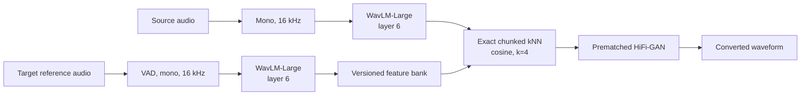

# Zero-Shot Voice Conversion with WavLM and kNN Retrieval

[](https://github.com/fatemehkhakii94/Zero-Shot-Voice-Conversion-with-WavLM-and-kNN-Retrieval/actions/workflows/ci.yml)
[](https://www.python.org/)
[](https://pytorch.org/)
[](LICENSE)

A reproducible, training-free voice-conversion toolkit. It preserves the source utterance's linguistic content while transferring the voice characteristics of a target speaker represented by a small reference bank. Adding a speaker requires no fine-tuning and no speaker-specific model training.

The project is an engineering-focused reimplementation around the released [`bshall/knn-vc`](https://github.com/bshall/knn-vc) WavLM and prematched HiFi-GAN checkpoints. It adds a typed package, one coherent CLI, exact memory-bounded retrieval, portable feature banks, checkpoint verification, leakage-safe evaluation, tests, and CI.

> Use voice conversion only with informed consent. Do not use this software for impersonation, fraud, harassment, or deceptive media.

## Results

The checked benchmark uses 40 held-out, cross-gender conversions from eight VCTK 0.92 speakers. Target-bank audio, speaker-similarity references, and source utterances are mutually disjoint.

| Metric | Source | Converted | Change |
|---|---:|---:|---:|
| ECAPA cosine similarity to target | 0.082 | **0.641** | **+0.559** |
| Whisper corpus WER | **4.17%** | 9.06% | +4.89 pp |
| DNSMOS overall | **3.265** | 3.250 | -0.015 |
| Median inference RTF | — | **0.0179** | about 56× real time¹ |

¹ Model inference only, measured on an NVIDIA RTX 2070 Super after one warm-up, with three measured runs per utterance. This small benchmark demonstrates the implementation; it is not a claim of state-of-the-art performance.

- [Full protocol and interpretation](benchmarks/vctk-0.92/README.md)
- [Machine-readable report](benchmarks/vctk-0.92/report.json)
- [Source, target, and converted listening example](examples/audio/p243-to-p244/README.md)

## How it works



For each source frame, the matcher retrieves the four closest target-speaker frames and averages them. Chunking keeps the search exact without allocating the full query-by-reference distance matrix. The released prematched vocoder then synthesizes the retrieved feature sequence at 16 kHz.

## What is included

- Installable `src/` package and a single `knnvc` command.
- Strict, validated YAML configuration with portable relative paths.
- CUDA/CPU device selection and Windows-compatible preprocessing without SoX.
- Atomic, self-describing feature banks with source and feature checksums.
- SHA-256 verification of the expected WavLM and vocoder checkpoints.
- Exact cosine kNN by default, with an explicit L2 ablation option.
- Conversion sidecars containing configuration, timing, device, and model provenance.
- Versioned evaluation manifests that reject target-reference leakage.
- Ground-truth WER, ECAPA speaker similarity, DNSMOS, confidence intervals, and repeated timing.
- Unit tests, strict type checking, linting, coverage enforcement, and GitHub Actions CI.

## Installation

The reproducible environment uses Python 3.11, PyTorch 2.6, and CUDA 12.4:

```bash
conda env create -f environment.yml
conda activate knnvc
```

For a lean, platform-specific install, install the appropriate PyTorch and torchaudio builds first, then install the package:

```bash
python -m pip install -e .
```

Install the evaluation stack with `python -m pip install -e ".[evaluation]"`. The first model-backed command downloads the upstream checkpoints to the normal user caches. They are never stored in this repository.

## Quick start

Build a reusable target-speaker bank from clean reference recordings:

```bash
knnvc bank build \
  --id target-speaker \
  --reference path/to/reference-01.wav path/to/reference-02.wav
```

Convert a source utterance:

```bash
knnvc convert \
  --source path/to/source.wav \
  --target-bank target-speaker
```

The default output is `artifacts/audio/source--to--target-speaker.wav`, accompanied by a JSON provenance sidecar. Existing files and banks are never replaced unless `--overwrite` is explicit.

Useful commands:

```text
knnvc bank build             Build one target feature bank
knnvc bank build-manifest    Build all banks in an evaluation manifest
knnvc bank list              Inspect available banks and their provenance
knnvc convert                Convert one source recording
knnvc data prepare-vctk      Create a deterministic, leakage-safe VCTK manifest
knnvc evaluate               Run the complete evaluation protocol
```

All commands accept `--config`; defaults live in [`configs/default.yaml`](configs/default.yaml).

## Reproducing the benchmark

1. Download and extract [VCTK Corpus 0.92](https://doi.org/10.7488/ds/2645). The official archive MD5 is `8a6ba2946b36fcbef0212cad601f4bfa`.
2. Build the eight target banks from the checked manifest.
3. Run the evaluation into ignored `artifacts/` output so the checked report stays unchanged.

```bash
knnvc bank build-manifest \
  --manifest data/manifests/vctk-0.92-evaluation.yaml \
  --dataset-root /path/to/VCTK-Corpus-0.92

knnvc evaluate \
  --manifest data/manifests/vctk-0.92-evaluation.yaml \
  --dataset-root /path/to/VCTK-Corpus-0.92 \
  --output artifacts/reports/vctk-local.json
```

See the [benchmark documentation](benchmarks/vctk-0.92/README.md) for the exact cohort, split, metrics, checkpoint fingerprints, and canonical regeneration command.

## Development

```bash
ruff format --check .
ruff check .
mypy
pytest --cov=knnvc --cov-report=term-missing
```

The test suite uses lightweight deterministic backends; it does not download model weights. Real WavLM, vocoder, Whisper, ECAPA, and DNSMOS integrations were exercised separately to produce the checked benchmark.

## Repository layout

```text
configs/                 Runtime configuration
data/manifests/          Versioned dataset splits; no raw datasets
src/knnvc/               Package, CLI, conversion, matching, and evaluation
tests/                   Deterministic unit and workflow tests
benchmarks/vctk-0.92/    Protocol and machine-readable benchmark evidence
examples/audio/          One curated listening example
.github/workflows/       Continuous integration
```

Generated banks, conversions, caches, datasets, and model weights are intentionally ignored. See [`THIRD_PARTY_NOTICES.md`](THIRD_PARTY_NOTICES.md) for upstream model and dataset attribution.

## Limitations

- This is retrieval-based conversion, not generative voice cloning; quality depends heavily on target-bank coverage and recording conditions.
- The prematched vocoder is compatible with WavLM-Large layer 6 at 16 kHz, so those settings are deliberately enforced.
- Long recordings are processed as a single utterance and can require substantial GPU memory.
- Objective metrics are proxies. Human listening tests remain necessary for perceptual claims.
- The checked benchmark is intentionally compact and does not compare against other systems.

## License

Project code is released under the [MIT License](LICENSE). Model weights and dataset excerpts retain their respective upstream terms.
